<div align="center">

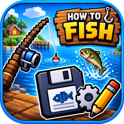

# How to Fish – Save Editor

**A modern, dark-themed save editor for the game _How to Fish_.**
Money, inventory, weapons, skins, journal, boat, islands – everything the save file stores, in one small EXE.

[](https://github.com/Yukitus86/HowToFish-SaveEditor/releases/latest)
[](https://github.com/Yukitus86/HowToFish-SaveEditor/releases)


[](LICENSE)

**English** · [Deutsch](#-deutsch)

<br>

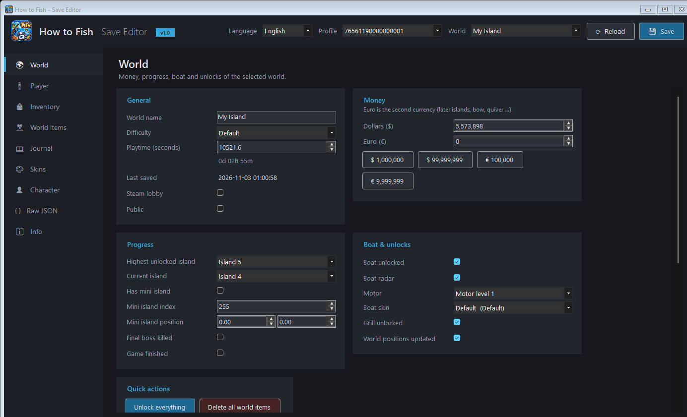

</div>

---

## ✨ Features

| | Tab | What you can edit |
|---|---|---|
| 🌍 | **World** | World name, difficulty, playtime, **dollars & euros**, highest / current island, mini island, boat, radar, motor, boat skin, grill, final boss – plus a one-click _Unlock everything_ |
| 🧍 | **Player** | Health, fullness, tutorial, **extra inventory slots** (0–5), **wishbone level** (0–5), the amount of **all 16 baits** |
| 🎒 | **Inventory** | Hand + every slot: item, **skin**, drip/shiny, weight, cookedness, multipliers, **sight, barrel, ammo level, extended mag, laser, quiver, sharpness** – with _Max out weapon_ |
| 🏝 | **World items** | Everything lying around: edit, duplicate, delete, move (position & rotation) |
| 📖 | **Journal** | Caught + drip state of all 68 creatures, bulk “all caught / all drip” |
| 🎨 | **Skins** | Unlock any weapon, tool or boat skin – one by one or all at once |
| 👤 | **Character** | Hat / outfit / accessory, all 10 colors, bean mode, mouse invert, game language |
| `{ }` | **Raw JSON** | Expert mode for everything else, with live validation |

**Also**

- 🌙 Dark theme throughout
- 🌐 **English** (default) and **German** – switch live at the top right, the choice is remembered
- 🛟 **Automatic backups** of the original files before every save
- ⚠️ Warns you if the game is still running (the game would overwrite your changes)
- 📦 **Single EXE** – no installation, no .NET runtime needed
- 🔒 Unknown fields are preserved – only what you change is written

## 📸 Screenshots

<table>
  <tr>
    <td>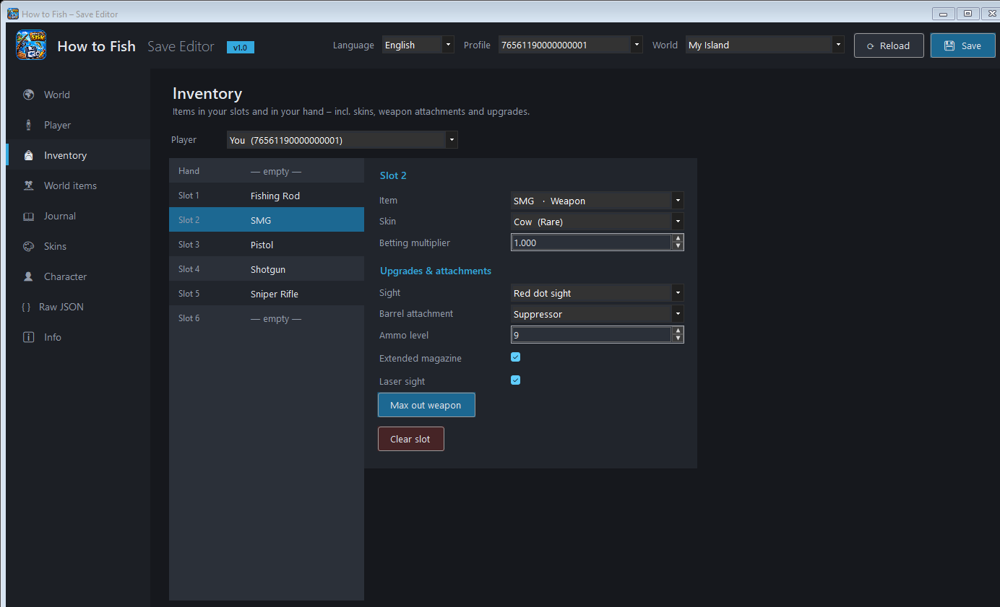<p align="center"><b>Inventory</b> – weapons, skins & attachments</p></td>
    <td>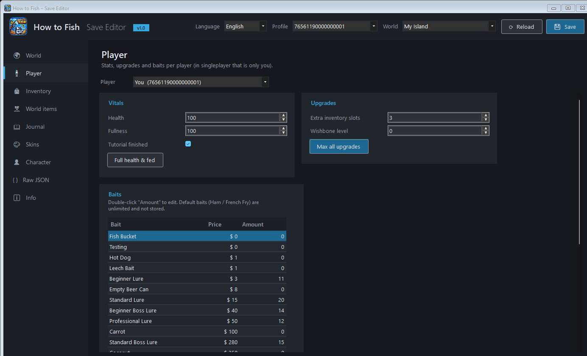<p align="center"><b>Player</b> – stats, upgrades & baits</p></td>
  </tr>
  <tr>
    <td>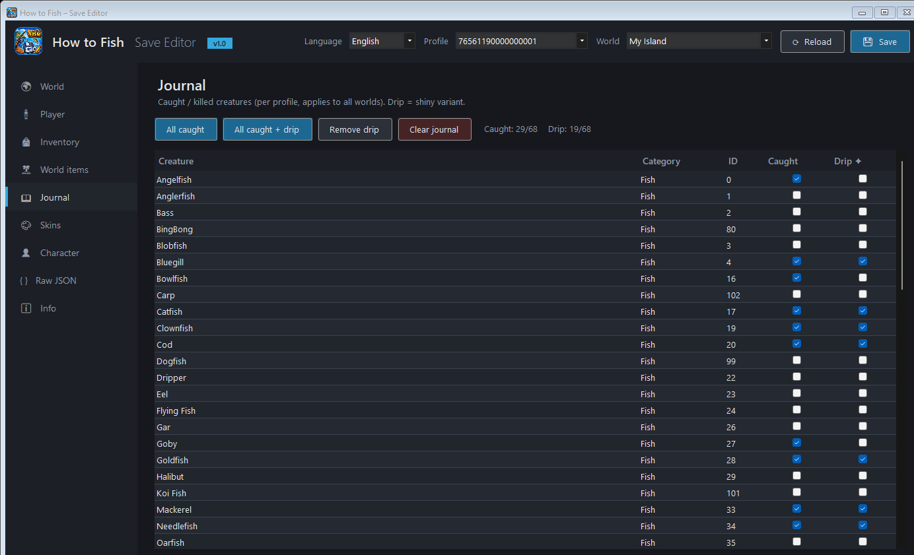<p align="center"><b>Journal</b> – caught & drip creatures</p></td>
    <td>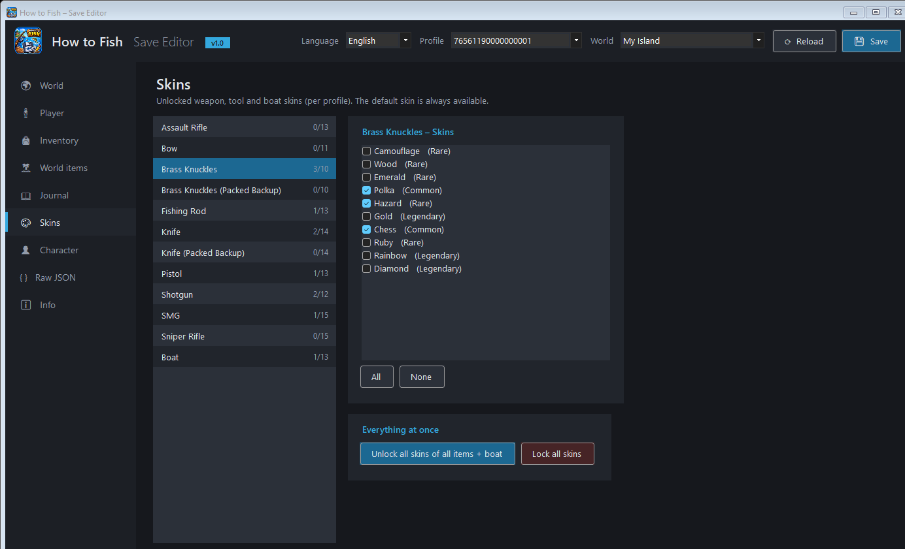<p align="center"><b>Skins</b> – unlock weapon, tool & boat skins</p></td>
  </tr>
  <tr>
    <td>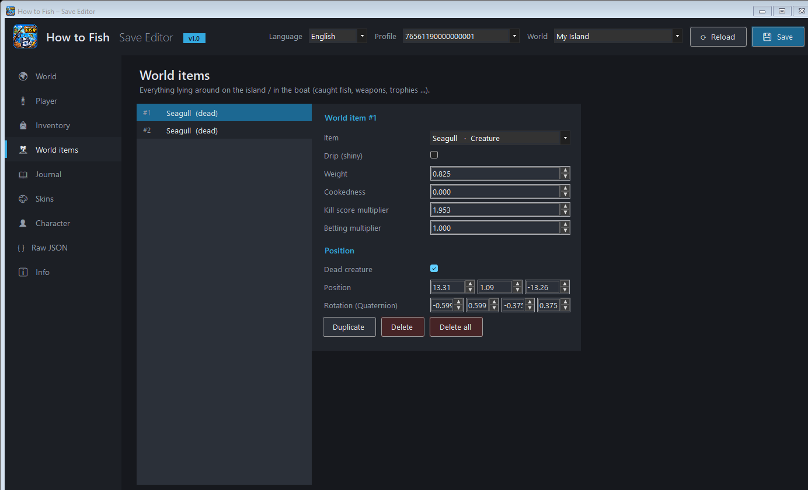<p align="center"><b>World items</b> – everything lying around</p></td>
    <td>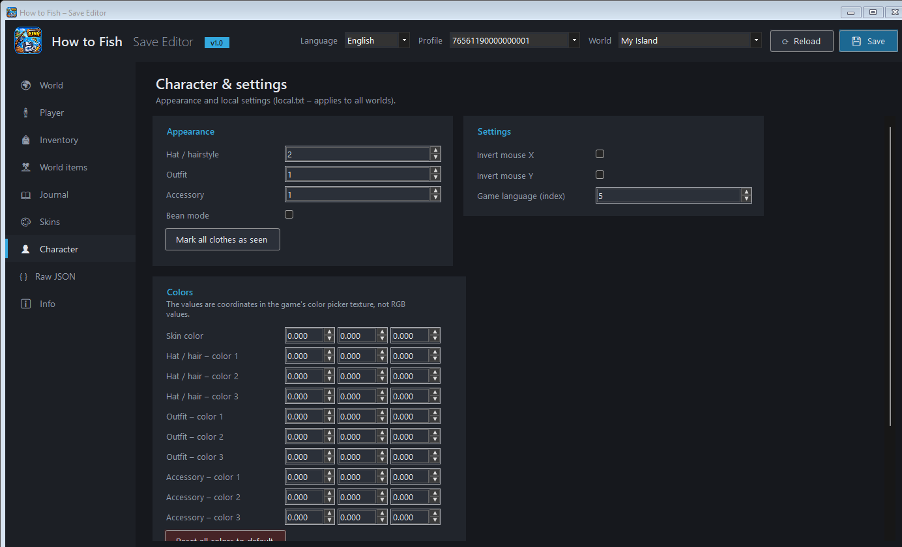<p align="center"><b>Character</b> – appearance & settings</p></td>
  </tr>
  <tr>
    <td>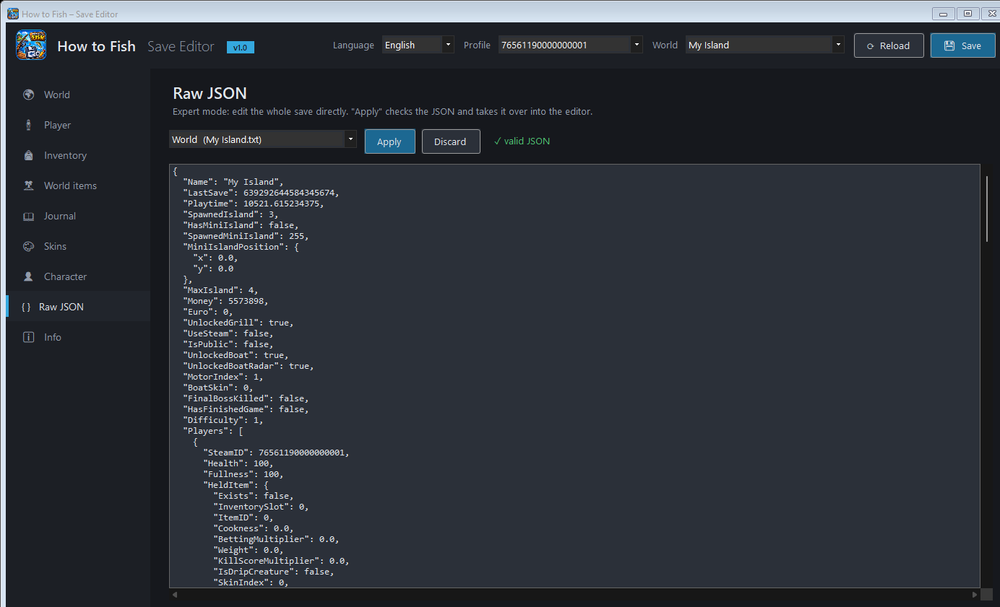<p align="center"><b>Raw JSON</b> – expert mode</p></td>
    <td>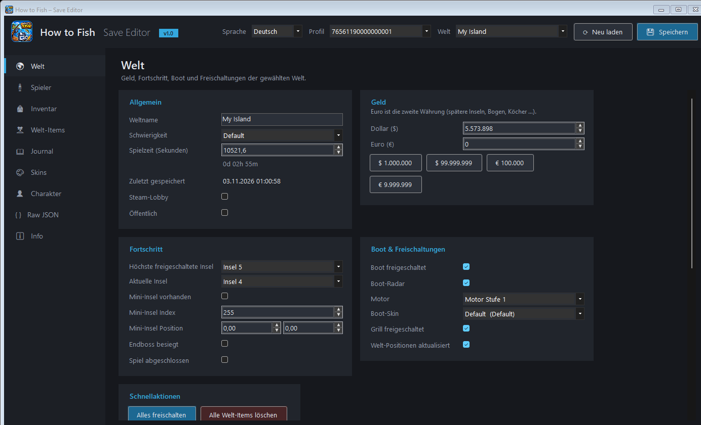<p align="center"><b>Deutsch</b> – full German UI</p></td>
  </tr>
</table>

## 🚀 Getting started

1. Download **`HowToFishSaveEditor.exe`** from the [latest release](https://github.com/Yukitus86/HowToFish-SaveEditor/releases/latest).
2. **Close _How to Fish_.**
3. Start the EXE – your profile and newest world are loaded automatically.
4. Edit, then hit **💾 Save** (`Ctrl+S`).

> [!TIP]
> Windows SmartScreen may warn about an unknown publisher because the EXE is not code-signed. Click **More info → Run anyway**.

### Where are the saves?

```
%USERPROFILE%\AppData\LocalLow\Dazed Games\How to Fish\Saves\<SteamID>\
├── <World name>.txt   ← world: money, inventory, boat, upgrades, world items
└── local.txt          ← profile: journal, skins, appearance, settings
```

Both are plain JSON (Unity `JsonUtility`). Backups made by the editor go to
`...\How to Fish\SaveEditorBackups\<SteamID>\<timestamp>\`.

## ❓ FAQ

<details>
<summary><b>My changes are gone after starting the game.</b></summary>

The game was probably still running and autosaved over them. Close the game, restore or redo your changes, save, then start the game.
</details>

<details>
<summary><b>Steam asks about a cloud conflict.</b></summary>

Choose the **local** files – those are the ones you edited.
</details>

<details>
<summary><b>Something broke – how do I go back?</b></summary>

Every save creates a timestamped backup (see above). Copy the files from there back into your save folder. The Info tab has buttons that open both folders.
</details>

<details>
<summary><b>Does it work in multiplayer?</b></summary>

Worlds are stored on the host's PC. Each player has their own entry in the world file – pick it with the player selector on the Player / Inventory tabs.
</details>

<details>
<summary><b>The game got an update and something looks wrong.</b></summary>

Item IDs, skins, baits and upgrade limits were read from the game files. If an update changes them, unknown values are shown as “Unknown (id)” and kept as they are. Use the Raw JSON tab and please open an issue.
</details>

## 🛠️ Building from source

Requires the [.NET 10 SDK](https://dotnet.microsoft.com/download) on Windows.

```bash
git clone https://github.com/Yukitus86/HowToFish-SaveEditor.git
cd HowToFish-SaveEditor
dotnet publish HowToFishSaveEditor -c Release -o Release
```

The result is a self-contained single file: `Release/HowToFishSaveEditor.exe`.

<details>
<summary>Project layout</summary>

```
HowToFishSaveEditor/
├── GameData.cs        item IDs, skins, baits, upgrade limits (extracted from the game)
├── SaveContext.cs     load / save / backup of local.txt and world files
├── Json.cs            helpers that edit the JSON in place (unknown fields survive)
├── L.cs               English / German texts + persisted language setting
├── Theme.cs           dark theme, colors, buttons
├── Controls.cs        form grid, cards, page base
├── ItemEditor.cs      editor for a single item (inventory + world items)
├── MainForm.cs        window, navigation, header, status bar
└── Pages/             one class per tab
```
</details>

---

## 🇩🇪 Deutsch

**Moderner Savegame-Editor im Dark Theme für _How to Fish_.** Die Oberfläche ist standardmäßig Englisch – oben rechts unter **Language → Deutsch** umstellen, die Auswahl wird gespeichert.

- **Welt:** Name, Schwierigkeit, Spielzeit, Dollar & Euro, Inseln, Mini-Insel, Boot, Radar, Motor, Boot-Skin, Grill, Endboss, „Alles freischalten“
- **Spieler:** Leben, Sättigung, Extra-Slots, Wishbone, alle 16 Köder
- **Inventar:** Item, Skin, Drip, Gewicht, Garstufe, Visier, Lauf, Munition, Magazin, Laser, Köcher, Schärfe
- **Welt-Items, Journal, Skins, Charakter, Raw JSON**
- Automatische Backups vor jedem Speichern, Warnung wenn das Spiel läuft, eine einzige EXE

**Benutzung:** EXE aus dem [neuesten Release](https://github.com/Yukitus86/HowToFish-SaveEditor/releases/latest) laden → **Spiel schließen** → Editor starten → bearbeiten → **Speichern**.

<div align="center">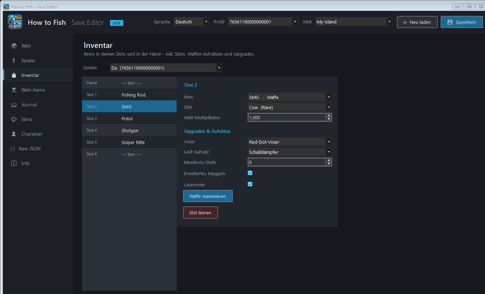</div>

---

## ⚖️ Disclaimer

This is an **unofficial fan project** and is not affiliated with or endorsed by Dazed Games.
_How to Fish_ and its name and assets belong to their respective owners.
Editing saves is at your own risk – the editor makes backups, but keep your own too.

Released under the [MIT License](LICENSE).
